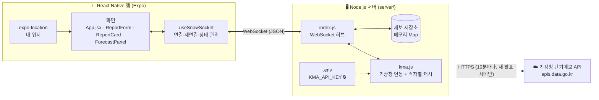
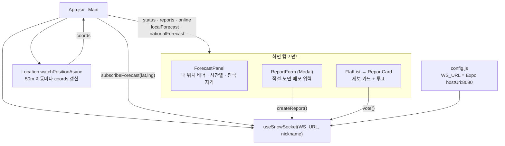
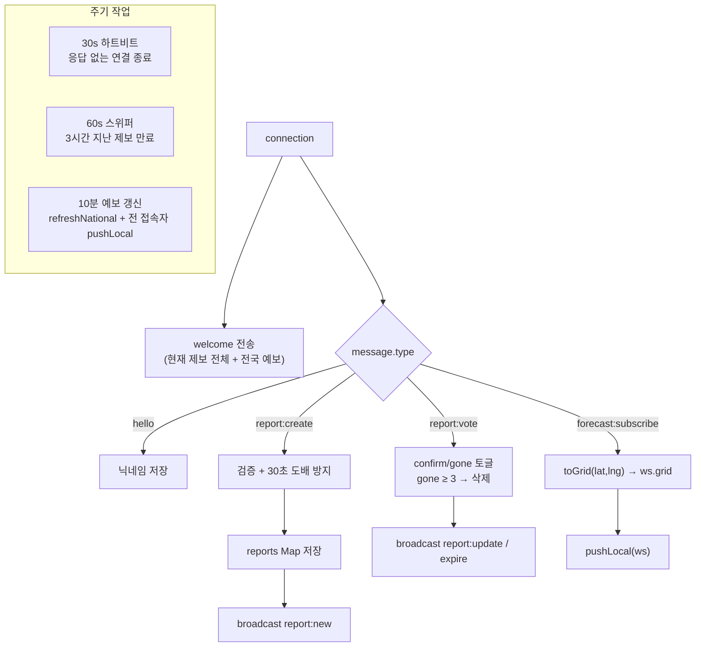
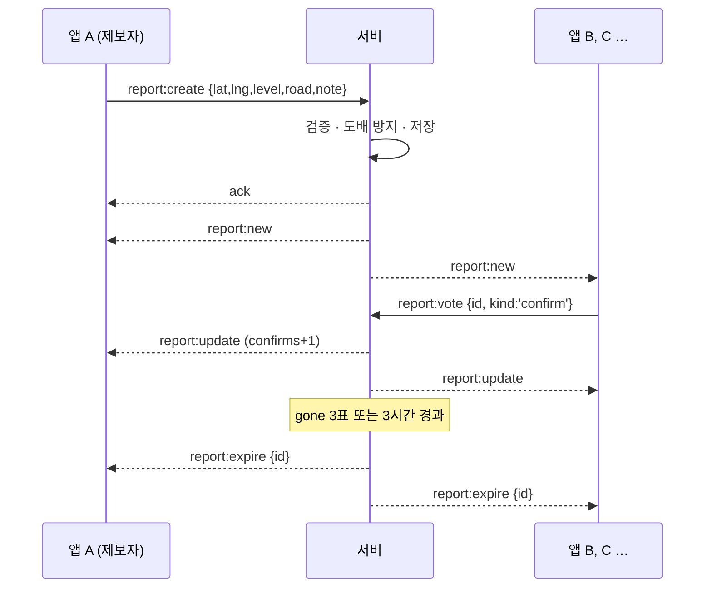
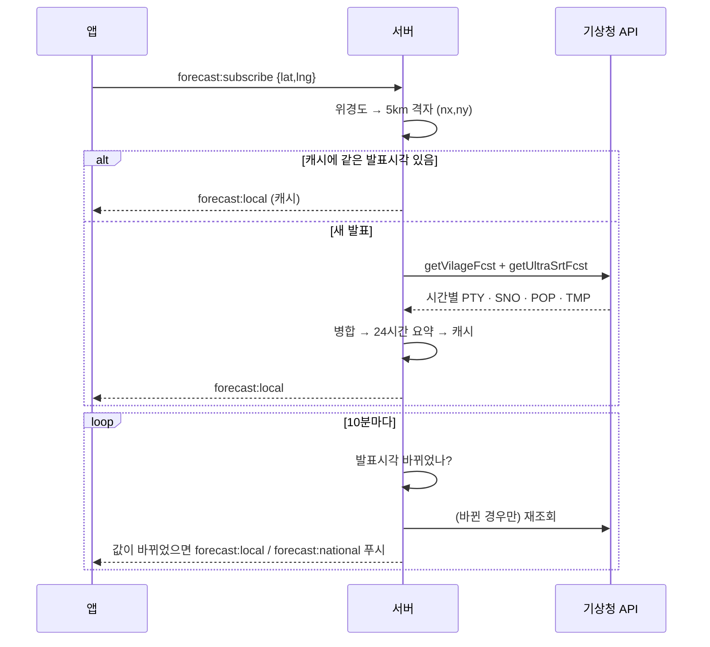
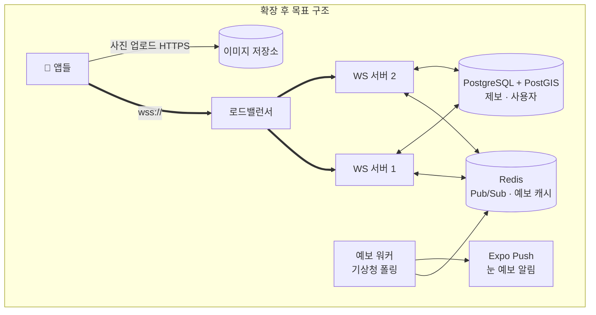

# snowweb 아키텍처

실시간 눈 제보 + 기상청 예보 앱. **React Native(Expo) 앱 ↔ Node.js WebSocket 서버 ↔ 기상청 API** 3단 구조이고,
앱과 서버 사이는 HTTP 없이 **WebSocket 연결 하나**로 모든 데이터가 양방향으로 오갑니다.

---

## 1. 전체 구조



| 계층 | 역할 | 핵심 파일 |
|---|---|---|
| 화면(View) | 그리기, 사용자 입력 | `App.jsx`, `src/components/*.jsx` |
| 통신·상태(Hook) | 서버 연결 유지, 받은 메시지로 상태 갱신 | `src/useSnowSocket.js` |
| 설정 | 서버 주소 자동 감지, 적설·노면 상수 | `src/config.js` |
| 실시간 허브 | 메시지 검증, 브로드캐스트, 만료·도배 방지 | `server/index.js` |
| 외부 연동 | 위경도→격자, 발표시각 계산, 예보 병합, 캐시 | `server/kma.js`, `server/regions.js` |

**원칙**
- 화면 컴포넌트는 WebSocket을 직접 만지지 않는다 → 통신은 전부 `useSnowSocket` 한 곳에서.
- 서버가 **단일 진실 원천**. 앱은 서버가 보낸 상태를 그대로 그리고, 직접 계산한 값(거리·필터)만 화면에서 더한다.
- 비밀값(API 키)은 서버에만. 앱 번들에는 절대 들어가지 않는다.

---

## 2. 앱 내부 구조



**상태가 어디 있는가**

| 상태 | 위치 | 출처 |
|---|---|---|
| `reports`, `online`, `clientId` | `useSnowSocket` | 서버 (welcome / report:* / presence) |
| `localForecast`, `nationalForecast` | `useSnowSocket` | 서버 (forecast:*) |
| `status` (connecting/open/closed) | `useSnowSocket` | WebSocket 이벤트 |
| `coords` | `App` | 휴대폰 GPS |
| `radius`, `nickname`, `formOpen` | `App` | 사용자 입력 |
| `myVotes` (내가 누른 투표 표시용) | `App` | 로컬 (서버는 개수만 보냄) |
| 거리·반경 필터 결과 | `App` `useMemo` | `reports` + `coords`로 계산 |

**연결 안정성 (`useSnowSocket`)**
- 끊기면 1s → 2s → 4s … 최대 15s 간격으로 자동 재연결
- 앱이 백그라운드에서 돌아오면 즉시 재연결
- 연결 전 보낸 메시지는 큐에 쌓았다가 연결되면 전송
- 재연결 시 `hello`(닉네임)와 `forecast:subscribe`(마지막 위치)를 자동 재전송 → 서버 재시작에도 화면이 복구됨

---

## 3. 서버 내부 구조



**서버가 메모리에 들고 있는 것**
- `reports: Map<id, report>` — 제보 (투표자는 `Set<clientId>`로 중복 방지)
- 연결별 속성 `ws.id / nickname / lastReportAt / grid / lastLocalSig`
- `national` — 전국 19개 지점 예보 요약
- `kma.js`의 `cache: Map<"nx,ny", {발표시각키, 시간별예보}>`

---

## 4. 주요 흐름

### 4-1. 제보 → 모두에게 실시간 전파



### 4-2. 기상청 예보 (키는 서버에만)



**눈 판단 기준**: 강수형태 `PTY ∈ {2 비/눈, 3 눈, 6 빗방울눈날림, 7 눈날림}` 이거나 신적설 `SNO > 0`.
가까운 6시간은 더 정확한 초단기예보로 덮어씀.

---

## 5. 메시지 프로토콜

모든 메시지는 `{ "type": "...", ... }` JSON.

| 방향 | type | 페이로드 |
|---|---|---|
| 앱→서버 | `hello` | `nickname` |
| 앱→서버 | `report:create` | `ref`, `payload{lat,lng,level(0~3),road,note?}` |
| 앱→서버 | `report:vote` | `id`, `kind: confirm \| gone` (다시 누르면 취소) |
| 앱→서버 | `forecast:subscribe` | `lat`, `lng` |
| 앱→서버 | `ping` | — |
| 서버→앱 | `welcome` | `clientId`, `reports[]` |
| 서버→앱 | `presence` | `count` |
| 서버→앱 | `report:new` / `report:update` | `report` |
| 서버→앱 | `report:expire` | `id` |
| 서버→앱 | `forecast:local` | `grid`, `hours[24]`, `summary{willSnow,start,end,totalSno,maxPop}`, `mock` 또는 `error` |
| 서버→앱 | `forecast:national` | `updatedAt`, `regions[]` |
| 서버→앱 | `ack` / `error` / `pong` | 접수 확인 / 사용자에게 보여줄 메시지 |

새 기능을 붙일 때는 **`도메인:동작`** 이름 규칙을 따르고, 서버 `switch`와 `useSnowSocket`의 `handleMessage`에 각각 한 줄씩 추가하면 됨.

---

## 6. 보안

| 항목 | 현재 |
|---|---|
| 기상청 API 키 | `server/.env`에만 저장, `.gitignore`로 커밋 제외. 레포에는 빈 양식 `.env.example`만 |
| 앱 → 기상청 직접 호출 | 없음 (앱을 뜯어도 키 없음) |
| 입력 검증 | 좌표 범위, 적설·노면 허용값, 메모 200자, 닉네임 20자 |
| 남용 방지 | 1인 30초당 제보 1건, 1인 1투표(토글) |
| 전송 구간 | 개발: `ws://` 평문 → **배포 시 `wss://`(TLS) 필수** (iOS는 평문 차단) |
| 신원 | 접속마다 임시 `clientId` (로그인 없음) → 재접속하면 다른 사람으로 취급 |

---

## 7. 현재 한계와 확장 로드맵

현재 구조는 **서버 1대 · 메모리 저장**이라 개발·소규모(수백 명 동시 접속)에 맞춰져 있음.

| 한계 | 영향 | 다음 단계 |
|---|---|---|
| 제보가 메모리에만 있음 | 서버 재시작 시 사라짐 | SQLite/PostgreSQL(+PostGIS)에 저장 |
| 모든 제보를 모든 사람에게 브로드캐스트 | 사용자가 늘면 트래픽 급증 | **지역 채널**: geohash(약 5km) 단위 방으로 나눠 근처만 전송 |
| 서버 1대 | 수평 확장 불가 | Redis Pub/Sub로 여러 서버 간 브로드캐스트 공유 |
| 익명 임시 ID | 투표 조작, 재접속 시 내 제보 구분 불가 | 기기 고유 ID(SecureStore) 또는 로그인 |
| 앱이 꺼지면 알림 없음 | 눈 시작을 놓침 | Expo Push: "내 위치 2시간 뒤 눈" 서버 발송 |
| 목록만 있음 | 위치 파악이 어려움 | `react-native-maps`로 제보 마커 + 예보 격자 오버레이 |
| 사진 없음 | 신뢰도 낮음 | 이미지는 HTTP 업로드(S3 등) → WebSocket으로는 URL만 |



---

## 8. 폴더 구조

```
snowmap/
├─ package.json            npm run setup / npm start (서버+앱 동시)
├─ .vscode/                VS Code 실행 태스크·추천 확장
├─ docs/ARCHITECTURE.md    이 문서
├─ server/
│  ├─ index.js             WebSocket 허브 (연결·라우팅·타이머)
│  ├─ kma.js               기상청 연동 (격자 변환·발표시각·병합·캐시·mock)
│  ├─ regions.js           전국 예보 대표 지점 19곳
│  ├─ test-client.js       2클라이언트 통합 테스트
│  ├─ .env.example         키 양식 (실제 .env는 커밋 금지)
│  └─ package.json
└─ app/
   ├─ index.js             진입점 (registerRootComponent)
   ├─ App.jsx              메인 화면, 위치 추적, 필터
   ├─ app.json             앱 이름·위치 권한
   └─ src/
      ├─ config.js         서버 주소 자동 감지, 상수
      ├─ useSnowSocket.js  WebSocket 훅 (재연결·큐·상태)
      └─ components/
         ├─ ForecastPanel.jsx
         ├─ ReportCard.jsx
         └─ ReportForm.jsx
```
